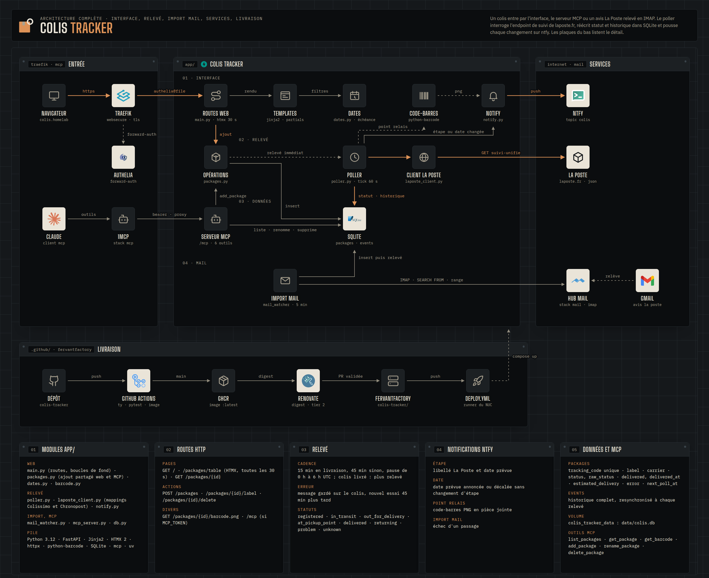

# Colis Tracker

Suivi de colis Colissimo et Chronopost auto-hébergé, sans clé API ni compte tiers.


La Poste et Amazon n'ont pas d'API grand public de suivi, et les agrégateurs (17TRACK, AfterShip) demandent un compte ou un abonnement. Comme la plupart des livraisons passent par La Poste, colis Amazon compris, l'appli interroge directement l'endpoint public (non officiel) que la page de suivi de [laposte.fr](https://www.laposte.fr/outils/suivre-vos-envois) appelle elle-même. L'endpoint et le mapping des statuts viennent de l'intégration Home Assistant [`ha-parcel-integrations/ha-laposte`](https://github.com/ha-parcel-integrations/ha-laposte).

## Fonctionnalités

- Ajout d'un colis par son numéro de suivi, depuis l'interface, le serveur MCP ou un avis La Poste reçu par mail.
- Relevé automatique : toutes les 15 min quand le colis est en livraison, toutes les 45 min sinon, pause de 0 h à 6 h UTC. Un colis livré n'est plus relevé.
- Historique complet à chaque relevé, La Poste renvoyant toute la chronologie.
- Notification [ntfy](https://ntfy.sh/) à chaque changement d'étape ou de date prévue, avec le code-barres en pièce jointe quand le colis attend en point relais.
- Interface sombre aux couleurs de la charte HomeLab, rafraîchie toutes les 30 s.
- Stockage SQLite en fichier (`data/colis.db`).

## Architecture



Un seul processus FastAPI. Au démarrage, il lance deux boucles de fond : le poller, qui relève chaque minute les colis arrivés à échéance, et l'import mail, qui passe toutes les 5 min si IMAP est configuré. L'interface et le serveur MCP passent par la même fonction d'ajout ([`app/packages.py`](app/packages.py)), qui enregistre le colis et lance un premier relevé.

Le schéma se régénère depuis [`docs/architecture/architecture.html`](docs/architecture/architecture.html) :

```bash
google-chrome --headless=new --disable-gpu --hide-scrollbars --force-device-scale-factor=1.5 \
  --window-size=1840,1500 --screenshot=docs/architecture/architecture.png \
  "file://$PWD/docs/architecture/architecture.html"
```

## Démarrage rapide

```bash
docker compose up -d
```

L'application écoute sur `http://localhost:8000`.

## Configuration

Toutes les variables sont optionnelles.

| Variable | Défaut | Rôle |
|---|---|---|
| `NTFY_URL`, `NTFY_TOPIC` | aucun | serveur et topic ntfy ; sans eux, pas de notification |
| `IMAP_HOST`, `IMAP_USER`, `IMAP_PASSWORD` | aucun | boîte surveillée ; sans eux, pas d'import mail |
| `IMAP_PORT` | `993` | port IMAPS |
| `IMAP_FOLDER` | `INBOX` | dossier lu |
| `MAIL_PROCESSED_LABEL` | `colis-tracker/traite` | dossier où sont rangés les mails traités |
| `MAIL_WATCH_INTERVAL_MINUTES` | `5` | intervalle de l'import mail |
| `MCP_TOKEN` | aucun | active le serveur MCP sur `/mcp` |

### Import par mail

L'appli lit la boîte en IMAP standard, sans OAuth ni API Google. Sur Gmail, il faut un [mot de passe d'application](https://myaccount.google.com/apppasswords) (validation en deux étapes requise), jamais le mot de passe du compte.

Seuls les mails des domaines La Poste (`notif-colissimo-laposte.info`, `laposte.fr`) sont analysés. Chaque mail traité, numéro trouvé ou non, part dans `MAIL_PROCESSED_LABEL` pour ne pas être relu. Un passage en échec envoie une notification ntfy.

### Serveur MCP

Avec `MCP_TOKEN`, l'appli expose un serveur MCP en streamable HTTP sur `/mcp` ; chaque requête porte `Authorization: Bearer <MCP_TOKEN>`. Sans la variable, la route n'existe pas.

```bash
MCP_TOKEN=$(openssl rand -hex 32)
```

Outils : `list_packages` (filtre en cours, livrés, en erreur), `get_package` (id ou numéro de suivi, avec l'historique), `get_barcode` (PNG), `add_package`, `rename_package`, `delete_package`.

## Endpoint La Poste

[`app/laposte_client.py`](app/laposte_client.py) appelle :

```
GET https://www.laposte.fr/ssu/sun/back/suivi-unifie/{tracking_code}?lang=fr
User-Agent: PostmanRuntime/7.49.1
```

Pas d'authentification, mais l'edge renvoie 403 à un user-agent identifié comme robot, d'où celui de Postman. Ce n'est pas une API documentée : elle peut changer sans préavis. Si un colis reste bloqué sur une erreur, ouvrez une issue avec le code renvoyé.

## Limites

- Colissimo et Chronopost seulement (groupe La Poste) : pas de Mondial Relay, DPD ni GLS.
- L'import mail lit les avis La Poste, y compris ceux des commandes Amazon expédiées par La Poste, mais pas les mails d'Amazon.

## Développement

Le projet utilise [uv](https://docs.astral.sh/uv/) ; voir aussi [CONTRIBUTING.md](CONTRIBUTING.md).

```bash
uv sync
uv run uvicorn app.main:app --reload
uv run pytest         # tests
uv run ty check app   # types
```

## Licence

[MIT](LICENSE)
